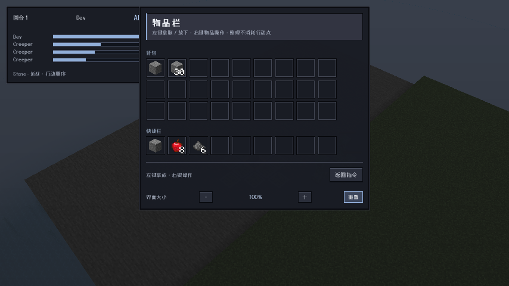
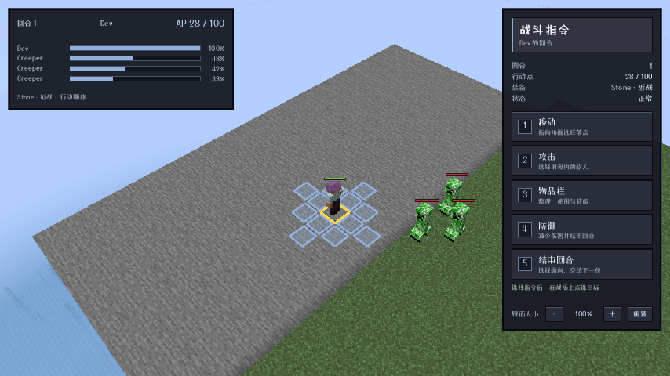

# 0.14.0 验收记录

适用：Minecraft 1.21.1 / NeoForge 21.1.216；ApricityUI 1.2.8；Dungeons Perspective 3.6.3。其他加载器和游戏版本本轮未移植、未验收。

## 实际客户端验证

使用 `runClient` 启动真实客户端；Agent Helper 通过 Minecraft 的鼠标/键盘输入回调操作，读取服务端往返后的槽位状态，并保存游戏截图。未将几何命中或直接发送意图包作为 GUI 操作通过依据。

| 项目 | 验证结果 |
| --- | --- |
| 物品栏 | 真实左键拿起整组、放入空格；右键操作菜单；持物右键放下 1 个；服务端往返后数量正确。背包 9–35 / 快捷栏 0–8 顺序正确，图标居中。 |
| 界面尺寸 | 点击增大、缩小、重置后，界面重新布局，仍可操作；不再使用 Ctrl+滚轮作为尺寸入口。 |
| 朝向 | 悬停东按钮得到 yaw=270；未结束回合；返回后恢复原朝向；点击北按钮才提交结束回合。地牢视角逐帧覆写朝向的兼容路径已实际覆盖。 |
| 一格落差 | 三个相邻方向被敌人占据，鼠标选中剩余方向低 1 格的落点；到达 `(-1,99,0)`，AP 100→88。 |
| 转弯移动 | 鼠标点选五步、两段路径；实际采到两个方向 yaw=0/90；AP 88→28，镜头有 15 个不同的中间位置。 |
| 镜头切换 | 真实结束回合后跟踪敌方、再返回玩家；采集连续中间位置，切换采用约 0.36 秒过渡。战斗结束关闭战术界面并恢复正常视角。 |
| 玩家箭矢 | 鼠标选敌并射出真实光灵箭；客户端存在飞行投射物；命中后目标死亡、原占用格进入可移动集合；AP 100→65、弹药 16→15、弓耐久损耗 1。为拍摄飞行过程，测试场景临时降至 5 TPS，结束后恢复 20 TPS。 |
| 范围覆盖 | `#91afd9` 浅蓝色，单边内缩 0.09 格，宽度 0.82 格。鼠标落点提示与实际移动落点一致。 |

## 自动验证

- `:common:test`：22 项通过（寻路、高差、占用、路径插值、朝向、抛射物瞄准、AP/回合规则）。
- `:neoforge-1.21.1:build`：构建成功；9 项镜头过渡测试、3 项 UI 资源契约测试通过，共 34 项单元/资源测试。
- `:neoforge-1.21.1:runServerRegression`：日志出现明确的 `REGRESSION PASSED`，覆盖下台阶与转向、死亡同步刷新、光灵箭真实伤害/弹药/耐久/AP、同高度墙体视线、已装填弩在没有散装箭时射击、飞行期间操作锁。
- 无头测试早期的场景失败（FakePlayer 所在区块未加载、近处单位挡住远处目标）已调整场景后重跑；未把进程退出码 0 当作通过依据。

## 交付边界

- 主要镜头验收使用地牢视角。关闭该视角后的第一人称敌方焦点仍可能出现近距离遮挡，未作为本轮完整镜头支持承诺。
- 真实箭矢有原版碰撞：遮挡物和途经单位可能挡箭，不再保证点中目标就直接扣血。
- 已补充最小化窗口宽高为 0 的鼠标保护，以及 ATB 连续选中玩家时重新打开指令菜单的处理。
- 本记录不表示所有模组组合都已兼容；界面截图来自本地开发客户端。
