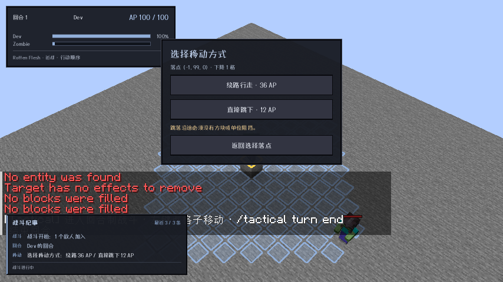
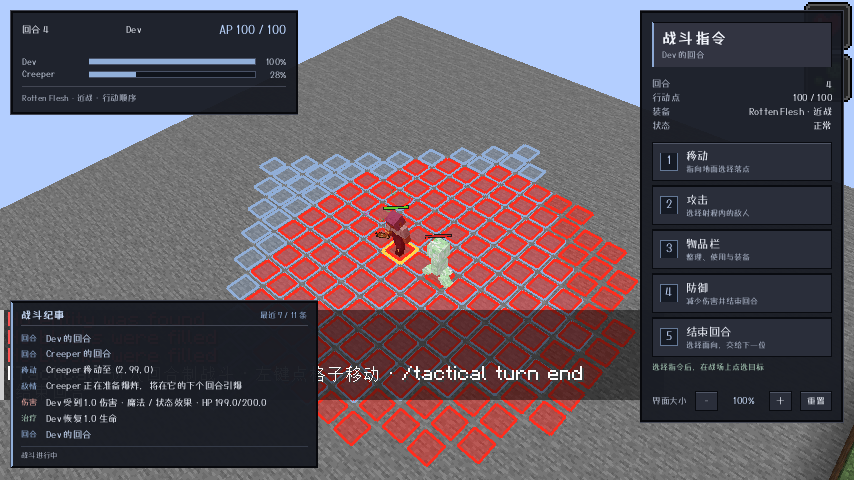
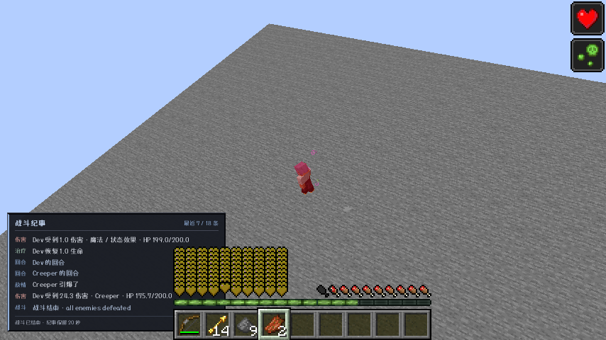

# 0.15.0 验收记录

目标：Minecraft 1.21.1 / NeoForge 21.1.216；ApricityUI 1.2.8；Dungeons Perspective 3.6.3。其他游戏版本和加载器未移植、未验收。

## 真实客户端

自主启动 `:neoforge-1.21.1:runClient`。场景布置使用原版命令，移动、路线按钮、结束回合及朝向确认均通过 Minecraft 实际鼠标/键盘回调操作；只读探针采集位置、AP、实体状态和效果持续时间。截图来自游戏，不以直接发送战斗意图或几何断言替代 GUI 验收。

| 场景 | 实测结果 |
| --- | --- |
| 同时存在步行绕路和直接跳落 | 鼠标点击低一格落点出现选择页：绕路 36 AP、跳下 12 AP。实际选绕路沿三步路径到达，AP 100→64；另一次选择跳下，AP 100→88。 |
| 取消路线选单 | 实际点击“返回选择落点”回到目标选择页，位置和 AP 不变。 |
| 没有步行路线 | 三格高独立立柱上的玩家点击相邻低处落点，直接跳下到 `(-1,99,0)`，AP 100→88；不伪造绕路选项。 |
| 苦力怕 | 实际结束回合并确认朝向；苦力怕从 8 格外接近，停在水平距离 2 格，日志提示准备；红色格面覆盖潜在爆炸范围。等待 3.5 秒未自行爆炸，自己的下个回合引爆。 |
| 效果 | 玩家中毒/生命恢复在空等 2.5 秒期间持续时间不变；完整自身周期后同步剩余时间减少约 200 tick。持续伤害/治疗及准确持续时间另由真实服务端效果测试验证。 |
| 日志与清理 | 左下角出现回合、移动、攻击、伤害、治疗、准备爆炸、引爆、死亡及战斗结束记录；结束后保留 20 秒。苦力怕死亡/战斗结束后红色预警清除。 |
| 区域显示 | 原战斗蓝色边界圈不再出现；浅蓝色内缩可移动格仍保留，红色是爆炸预警，不是战场边界。 |

## 自动验证

- `:common:test`：34 项通过。
- `:neoforge-1.21.1:build`：构建成功，模块测试 29 项通过；合计 63 项单元/资源测试。
- `:neoforge-1.21.1:runServerEffectsTest`：明确出现 `EFFECTS SELFTEST PASSED`。覆盖首次基线、冻结、完整自身周期 200 tick、单次中毒/恢复、快速连续周期、属性、隐藏效果链、无限效果、刷新/替换、瞬间效果、自定义周期效果、到期取消及清理。
- `:neoforge-1.21.1:runServerCreeperTest`：明确出现 `CREEPER SELFTEST PASSED`。覆盖实际接近、1–2 格准备、原版 Fuse/点燃保持 220 tick、下个自身回合原版爆炸、参与者伤害和 mobGriefing、多只苦力怕、充能/NBT 半径、预警编码、死亡/结束/新战斗清理。
- `:neoforge-1.21.1:runServerRegression`：明确出现 `REGRESSION PASSED`。覆盖下台阶/转向、死亡刷新、真实光灵箭、视线、已装填弩、弹药/耐久/AP 与飞行锁定。
- 最终发布 jar 检查资源包元数据、四份 Mixin 配置及其类、路线页/日志页/字体与版本；未打包 Agent Helper。

## 测试中发现并解决的问题

- 运行时不能把台阶曲线两端以直线相连再扫碰撞：该弦线会切进台阶边缘。现按同一轨迹的实际进度区间采样。
- 原版 `noCollision` 不包含所有活体；额外检查沿途活体，且运行中重新检查动态障碍。
- 无法跳落不能退回未经碰撞验证的直接下行路线；普通上下台阶和显式跳落分开采样。
- 路线选单报价发生变化时拒绝旧报价，不静默增加 AP；未完成移动被阻挡时退回最近完成格并退还未完成步数 AP。
- NeoForge FakePlayer 天生免疫伤害；效果测试改用真实参与者苦力怕承受中毒，不能用假玩家无伤判定效果引擎失败。
- 弓命中后立即测试弩会遭遇原版受伤冷却；回归场景等待自然冷却结束后再验证弩命中，没有删除真实伤害断言。
- 服务器测试异常时运行任务仍可能退出 0；通过依据是明确 PASS 标记和无 FAILED 标记，而非仅退出码。

## 发布产物

- `tactical-neoforge-1.21.1-0.15.0.jar`：721338 字节。
- SHA-256：`178b956bd385adb57b27dd4c8e9f64aaa1db472065fecc18b87b9aebe9bf3c1c`。
- 开发分支：`main`；仅现有 NeoForge 1.21.1 模块。发布时另附源码 jar。

## 边界

- 红色格面是保守的可能波及范围，并非每个红格都必然破坏；实际爆炸保留原版遮挡、充能、NBT 半径和游戏规则。
- 其他模组的自定义周期回调每完整自身周期最多调用一次；其内部效果未必等价于原版 10 秒逐 tick 模拟。原版瞬间效果及苦力怕遗留区域效果云维持原有生命周期。
- 效果中途新加、刷新或替换后，下个自身回合先建基线，随后完整自身周期才扣时。
- 协议已变化，客户端/服务端须同时更新到 0.15.0。
- 主要镜头验收使用地牢视角；关闭它后的第一人称敌方镜头仍有既有限制。
