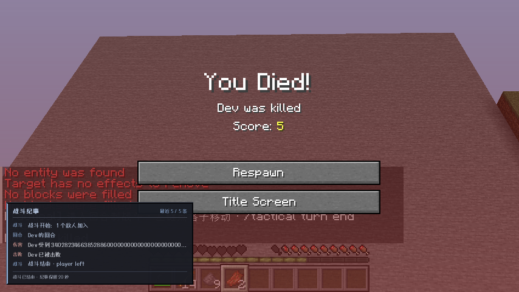
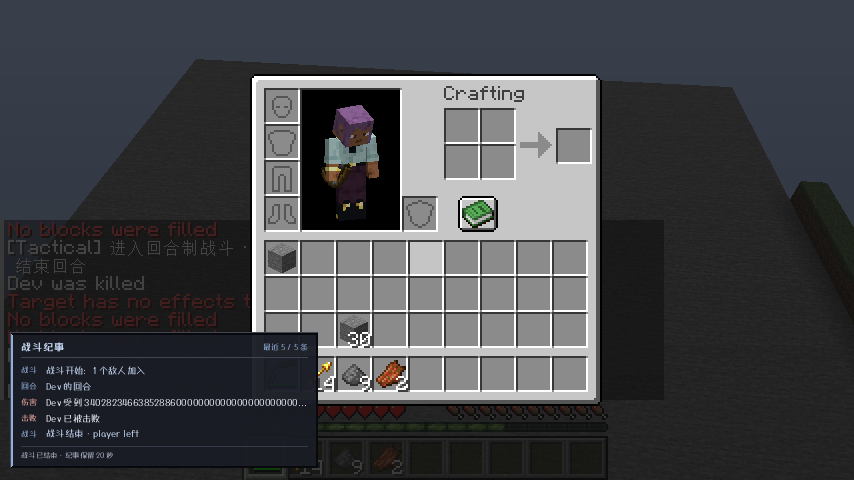

# 0.15.1 死亡退出与多人在线隔离验收

范围：`main` / Minecraft 1.21.1 / NeoForge 21.1.216；ApricityUI 1.2.8；Dungeons Perspective 3.6.3。没有移植其他版本。

## 修复

根因：`ServerBattle.finish` 原来只在所属玩家仍活着时发送 inactive 状态；死亡后服务器会结束战斗，但客户端一直认为 active。现在，只要所属玩家仍连接就发送退出快照，不向其他玩家广播。

- 客户端仅根据**本地玩家**死亡、断线、实体替换或世界切换清理；完整重置行动者、AP、参与者、格子、模式、移动动画、镜头和战术 HUD。保留原版死亡画面，日志按原规则保留 20 秒。
- 服务端退出按所属玩家的对象身份检查；重生事件只在明确的实体替换边界用 UUID 关联旧对象。无关玩家死亡/退出/重生不调用全局 reset，非所属玩家不能通过 stop 停止当前战斗。
- 死亡判断在实际 tick 状态执行，取消死亡并复活的事件不会错误结束战斗。
- 死亡、移除或旁观玩家不能启动战斗。`/tactical auto off` 不再被配置值覆盖。

## 自动验证

- `:common:test`：34 项；`:neoforge-1.21.1:build`：30 项模块单元/资源测试；共 64 项通过。新测试验证客户端完整状态清理及幂等性。
- `:neoforge-1.21.1:runServerDeathTest`：明确 `DEATH SELFTEST PASSED`。
  - 同一 ServerLevel 内同时存在两个不同 UUID 的真实 ServerPlayer（不是免疫死亡的 FakePlayer）。
  - 其他玩家实际致命伤害/死亡、非所属玩家 stop 不结束所属玩家战斗，也不解除敌方冻结。
  - 所属玩家实际死亡后，下个 tick 退出，释放 AI/目标、效果时钟和战斗交互距离。
  - 使用真实 ServerGamePacketListenerImpl 和 EmbeddedChannel 支持的记录 Connection，确认死亡玩家仍收到恰好一次 inactive，其他玩家未收到该退出包。这验证实际服务器发送路径，不冒称两个远端客户端连接测试。
  - 死亡取消并恢复生命、同 UUID 重生在 tick 前后、旧对象发送动作、登录/重生/退出事件均验证玩家隔离。
- 原有 `runServerEffectsTest`、`runServerCreeperTest`、`runServerRegression` 均出现明确 PASSED，未只依赖任务退出码。
- 发布 jar 元数据、Mixin、UI 资源及未携带测试桥接模组的打包检查通过。

## 实际客户端

自主启动 `runClient`；场景由原版命令布置，鼠标/键盘经 Minecraft 输入回调。`/kill @s` 触发真实死亡，不直接改客户端战斗标记。

1. 玩家指令菜单打开时死亡：收到原版 DeathScreen，active=false，phase=INACTIVE，AP=0，actorEntityId=-1，格子/参与者清空，没有战术菜单或 HUD 挡住重生按钮。
2. 点击原版重生按钮：回到正常游戏，E 打开原版物品栏，B 不会打开旧战斗菜单。
3. 战斗 AUI 容器打开时再次死亡：同样退出；重生后原版背包正常。
4. 重复死亡后仍能开启并停止新战斗；关闭自动触发后不会立刻把新遭遇误判成旧状态残留。

## 发布产物

- `tactical-neoforge-1.21.1-0.15.1.jar`：737909 字节。
- SHA-256：`cdca7056ef7b25af195fc7ceb6e441f0e87adfd04ecf5ed690afcd971b078f49`。

## 多人边界

本轮支持的是**多人在线时的身份隔离**，不是新增多人共同参战。当前管理器仍只有一个单玩家战斗会话；其他在线玩家不是这场战斗的玩家参与者。不宣称并发多战场或合作队伍死亡规则已经实现。
