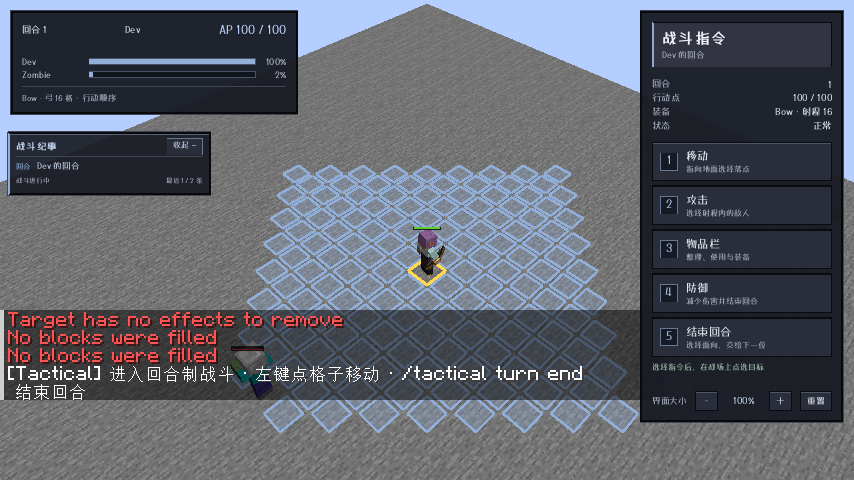
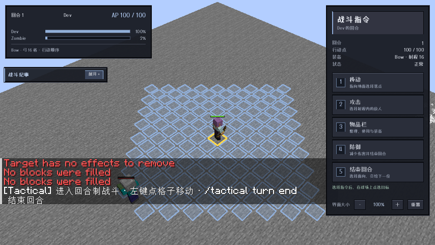
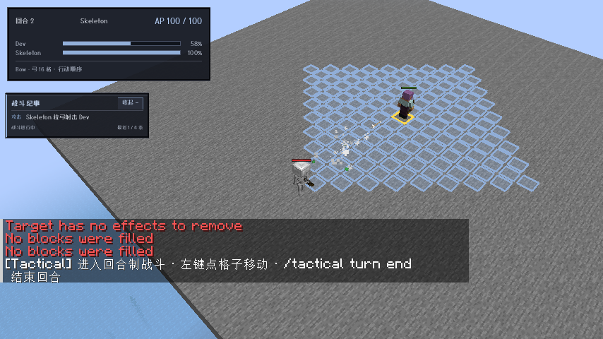
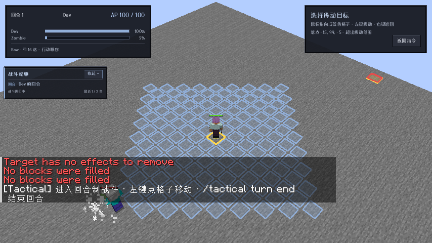

# 0.16.0 远程战斗、纪要与食物时钟验收

范围：`main`，Minecraft 1.21.1 / NeoForge 21.1.216，ApricityUI 1.2.8，Dungeons Perspective 3.6.3。其他游戏版本与加载器未移植。

## 行为与自动验证

- 玩家射击先根据目标计算朝向和可用弹道，不依赖起始朝向或角色视野锥。按实际方块与可命中实体检测；没有可行弹道时提示“转向后仍无法射中”，不扣 AP、弹药、耐久。原版武器仍产生真实箭矢并结算伤害，中央箭使用验证方向，多重射击侧箭保留原版行为。
- 骷髅持弓时使用远程战术：射程 16 格，偏好保持距离，必要时绕掩体或退后；预留 35 AP，每自身回合最多一发，箭矢结算后才轮转。仅普通骷髅注册了此适配，流浪者/沼骸暂未加入。
- 食物完整处理在每个完整自身周期调用一次原版食物 tick：消耗一份疲劳、条件满足时自然回血或饥饿伤害最多一次；首次自身回合建立基线。战斗外保持原版，游戏规则与难度限制保留。

`common` 34 项、NeoForge 模块 45 项单元/资源测试通过，合计 **79 项**。最终 jar 的版本、资源包元数据、Mixin 类、字体和 UI 资源检查通过，未携带 Agent Helper。

专用服务器以明确成功标记验收，而不只看 Gradle 退出码：

| 任务 | 实际验证 |
| --- | --- |
| `runServerRangedTest` | `RANGED SELFTEST PASSED`：背向玩家转向后真实弓箭命中；低掩体可用轨迹；完全封闭目标拒绝且保留资源；原版骷髅箭矢、真实玩家伤害、飞行锁、110 tick 等待不额外射击，下次骷髅自身回合再次射击。 |
| `runServerRegenerationTest` | `REGENERATION SELFTEST PASSED`：真实玩家与真实连接 tick；分别等待 120 个世界 tick 验证药水、自然回血、食物消耗与饥饿伤害均冻结；推进自身回合才结算，食物19→18、疲劳5→1；Hard 且自然回血关闭时，饥饿 HP10→9→8，每周期一次。受伤冷却在作用域后恢复。 |
| `runServerEffectsTest` | `EFFECTS SELFTEST PASSED`：药水首次基线、完整周期 200 tick、一次持续伤害/治疗、隐藏效果链、无限/瞬间效果、刷新替换与清理。 |
| `runServerCreeperTest` | `CREEPER SELFTEST PASSED`：苦力怕准备、原版引信冻结、下次自身回合爆炸及预警/清理未回归。 |
| `runServerDeathTest` | `DEATH SELFTEST PASSED`：死亡退出、重生、旧对象与多人在线身份隔离未回归。 |
| `runServerRegression` | `REGRESSION PASSED`：移动、真实光灵箭、遮挡、已装填弩、弹药/耐久/AP、飞行锁未回归。 |

早期测试场景纠正了两处错误预期：骷髅路径实际允许更短的两步路线；ATB 可合法连续选择骷髅，不能把两个自身回合的箭当成同一回合多射。最终按权威回合编号计数。一个效果测试开发启动曾遇到 FML 扫描类异常，源文件稳定后单独重跑明确通过，没有将该次启动视为通过。

## 实际客户端与输入

由 agent 自主启动 `runClient`；场景布置使用原版命令，界面选择、目标点选、纪要按钮、容器操作与结束回合均通过真实 Minecraft 输入回调。辅助桥接仅采集只读状态及截图，不打包进发布模组。

- 玩家实际点选敌人，观察到客户端真实光灵箭飞行和目标血量下降，AP100→65。
- 实际结束玩家回合，观察到骷髅箭矢飞行和玩家 HP100→97；箭矢仍在飞行时保持敌方当前行动者。
- 淡入后的战斗容器实际完成左键拿取/放下、右键物品操作、持物右键放一个以及增大/缩小/重置；服务端往返后的数量正确。
- 点击纪要“收起/展开”改变实际高度；其他透明区域继续点选战场。聊天与物品栏打开时隐藏纪要；战斗结束后纪要和战术窗口立即消失，不再保留 20 秒。
- 小窗口 854×480 中，纪要位于行动条 HUD 下方与聊天安全区上方，不覆盖快捷栏、生命/饥饿 HUD。空间不足时宁可隐藏，不覆盖原版界面。
- 7 类窗口配置原生 160ms 淡入、7px 位移与0.985→1缩放。真实打开目标窗口时记录渲染透明度 **0→0.571→1** 和变化的已提交几何矩形，并保存中间帧；未用基础 CSS opacity 常量冒充动画采样。
- 实机饥饿值归零后，两个 4.5 秒等待窗口 HP 不变；推进自身回合时 HP100→99，仅一次伤害。战斗外恢复原版。

## 发布产物

- `tactical-neoforge-1.21.1-0.16.0.jar`：783725 字节。
- SHA-256：`17c0277f008b69ef1ecdb116b5f1e8e27cf1851fc8743ff11dbebb023187ad16`。
- 发布附源码 jar；仅 NeoForge 1.21.1 分支范围。

## 根因与边界

药水生命恢复原本已有自身回合限制，造成实时回血的是原版饱食度自然回血分支；本轮按要求将整个食物处理统一纳入自身周期。疲劳可由行动或效果累积，实际扣除按每次一个原版4点单位处理，不把200个食物 tick 连续补算。

弹道按当前静态世界规划。发射后其他实体移动、方块变化或外部模组修改箭矢仍可改变实际命中，真实投射物不保证穿过后续新障碍。饥饿和治疗只处理对应参与者，其他在线玩家保持原版；本轮不新增多人共同参战。
