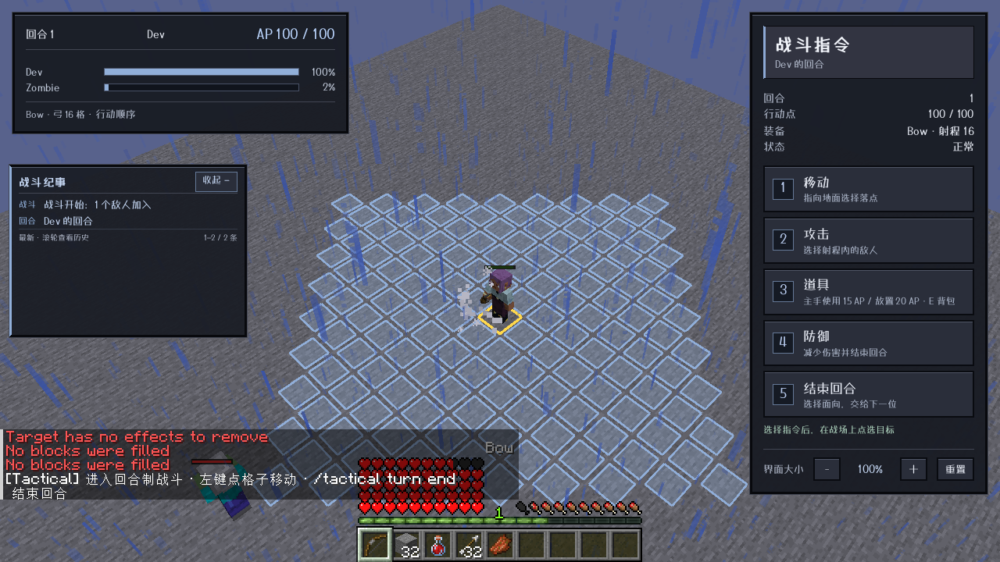
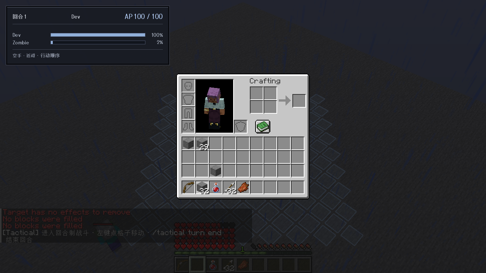
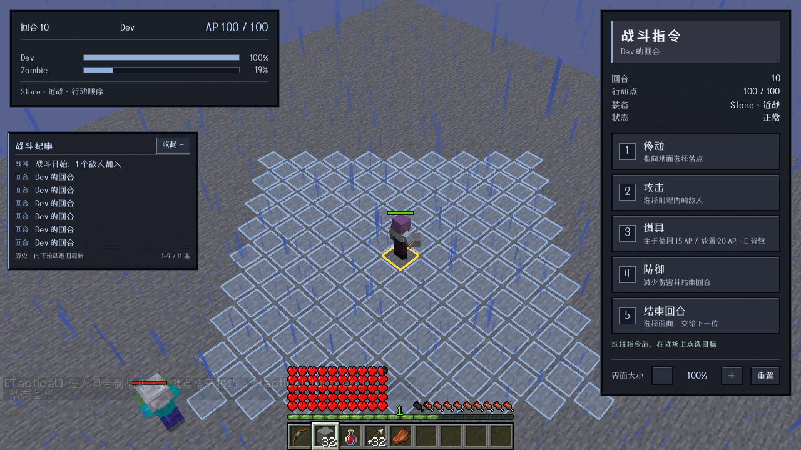
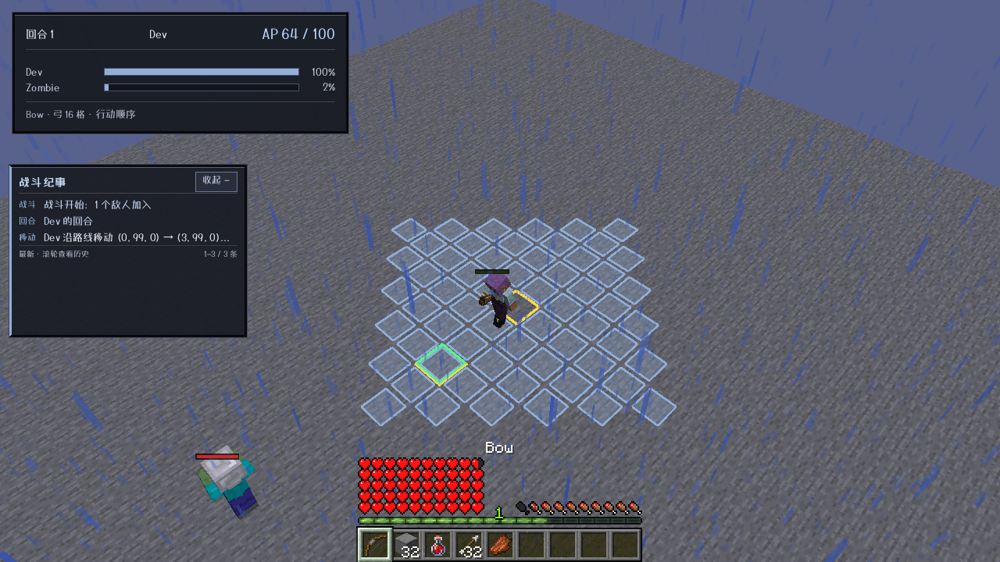

# 0.17.0 快捷栏、镜头输入、道具与燃烧验收

目标：`main`，Minecraft 1.21.1 / NeoForge 21.1.216，ApricityUI 1.2.8，Dungeons Perspective 3.6.3。其他版本没有移植。

## 九项改动及实际客户端结果

agent 自主启动 `runClient`，通过游戏鼠标/键盘回调、服务器同步状态和实际截图验收。场景布置使用原版命令；没有用几何命中或直接发送攻击意图代替 GUI 操作。

| 项目 | 实现与实测 |
| --- | --- |
| 快捷栏隐藏 | 现在只隐藏准星，保留原版快捷栏、生命、饥饿、经验等 HUD；实机截图确认可见。 |
| 任意战斗阶段选物品 | 1–9 与普通画面滚轮可以在菜单、攻击瞄准、移动中和敌方回合切换主手；模式不被清除。快捷栏 HUD 可点击/滚动，不误触背后战场。服务端同步的武器状态验证切换确实到达服务器。聊天和原版容器保留原有键盘含义。 |
| 拿起物品变小 | E 打开原版玩家背包，不再进入旧 AUI 背包。实际拿起、放回石头堆并确认服务器数量；原版槽位与光标物品使用相同尺度。旧 AUI 的放大槽位/原始光标大小差异没有被伪装成全局库修复。 |
| 淡入卡顿 | 等待初始布局完成及两帧边界稳定，使用 200ms 仅透明度淡入，删除位移/缩放，结束后移除持续动画规格。常规窗口采样约16.4–17.7ms/帧，常见最大值约18–24ms。冷启动/场景创建仍出现54–132ms尖峰，不能保证所有机器首次打开零卡顿。 |
| 地牢镜头与 HUD 分流 | 画面空白处中键拖动、中键加滚轮调用已安装地牢视角的原有处理函数；GUI/HUD 不穿透到镜头。实机确认镜头位置改变、GUI 手势不改变镜头，且从 GUI 开始的中键手势拖入画面也不会突然控制镜头。普通画面滚轮仍选快捷栏。 |
| 燃烧 | 等待真实时间3.5秒，着火敌人生命不变；进入它的下个自身回合才从19→18。每完整自身周期扣200 fire ticks，并至多执行一次原版 onFire 伤害；首次自身回合建立基线。抗火、水雨灭火正常，熔岩接触伤害不改。 |
| 入战卡方块 | 冻结前搜索最近的可安全站立位置，检查完整身体碰撞、实体占用和支撑；初始参与者、后加入攻击者、旁观者及后进入战场的旁观者均使用该检查。没有候选时跳过，禁止强塞进方块。真实服务端场景验证嵌入方块的移动生物和分数 X/Z 坐标。 |
| E 原版背包 | 移除“物品栏”菜单按钮；E 在玩家或敌方回合都可打开原版背包，旧网络背包入口不再打开自定义容器。 |
| 主手道具 | 新“道具”按钮按当前主手进入使用或放置模式；更换主手后模式提示跟随更新。实机喝治疗药水正确扣15 AP，放置石头扣20 AP。仅成功执行才扣费；服务端校验当前主手槽，弓弩走攻击、盾牌走防御。 |

## 纪要历史

鼠标悬停纪要时，向上查看旧记录、向下回到最新记录；历史视图按条目序号锚定，新消息到达不把旧内容推走。实机从 `5–11 / 11` 滚到 `1–7 / 11`，并能返回最新。边界仍消费滚轮，不转成镜头缩放；左键点击拦截仍仅限真实按钮。

## 自动回归与打包

- `common` 34项、NeoForge模块51项 JUnit/资源测试通过，共85项。
- 独立输入策略运行 `BattleInputPolicyPureTest`：96个检查通过，覆盖界面/画面分流、手势来源、滚轮、槽位环绕及特殊输入。
- `runServerSafetyTest` 明确 `SAFETY SELFTEST PASSED`：真实世界80tick燃烧等待、600→400→200→0、一次伤害、连续刷新/重新点燃、受伤冷却、抗火、灭火、战斗外恢复、初始及后续安全部署、阻挡和无候选行为。
- `runServerRangedTest`、`runServerRegenerationTest`、`runServerDeathTest`、`runServerRegression` 均明确 PASSED，覆盖真实箭矢与伤害、完整食物时钟、玩家死亡/多人在线隔离和既有战斗逻辑。
- `runServerCreeperTest` 与 `runServerEffectsTest` 单独回归，确认新燃烧/部署没有破坏苦力怕和药水效果。
- 最终 jar 检查版本、资源包元数据、所有 Mixin 配置及插件/类、字体/UI资源；不携带 Agent Helper。

测试曾纠正场景假设：后加入的敌人不是一出生就自动被吸收，真实入口是外部攻击触发的 `tryAbsorb`；场景改为调用该入口后，再验证站位安全及后续20tick无卡墙。燃烧实机复测也排除仍在死亡动画中的实体，并固定晴天，避免把正常雨水灭火误判成回合伤害失败。未把服务器异常后可能返回的退出码0当成通过依据。

## 发布产物

- `tactical-neoforge-1.21.1-0.17.0.jar`：823499字节。
- SHA-256：`bf52b55098b32c1a73e8ec758678c733450c1287f78d0025bc9dffccb5637089`。
- 发布另附源码 jar；本轮范围仅为 NeoForge 1.21.1。

## 环境与边界

测试期间 Windows 远程桌面断开，加载器预览报找不到主显示器。没有安装新驱动或使用管理员绕行：复用系统已有虚拟桌面，在本地 run 配置关闭 earlyWindowControl 后恢复了1280×720实际窗口和输入；该测试目录配置不会打入发布包。不可用音频设备通过仅对测试进程设置 ALSOFT_DRIVERS=null 避免持续重试。此环境下采集的帧耗时不等于所有硬件的表现。

安全部署保留可用的分数X/Z，当前网格模型的脚底Y仍为整数，不承诺任意半砖表面和所有大型/乘骑实体组合。镜头桥接针对实测的 Dungeons Perspective3.6.3，未安装时保留普通战斗输入；不自行重写该模组的相机数学。燃烧时钟仅适用于燃烧状态，熔岩/火源接触等环境交互仍按原版。当前仍是单玩家战斗会话，其他在线玩家不会被本场效果时钟接管。
