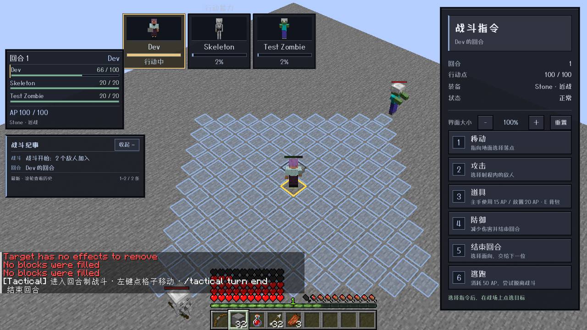
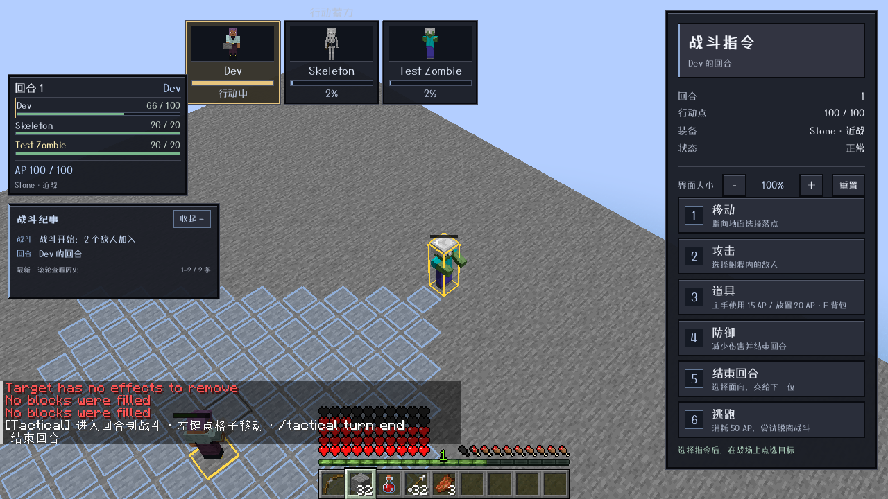
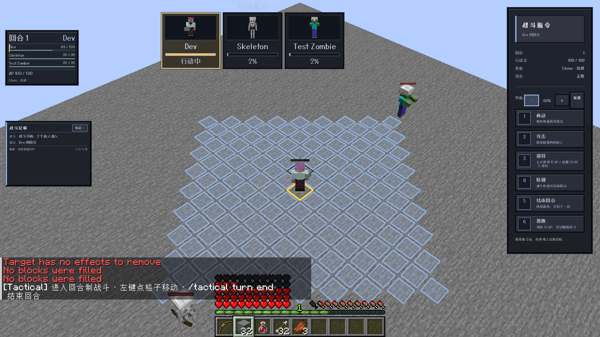
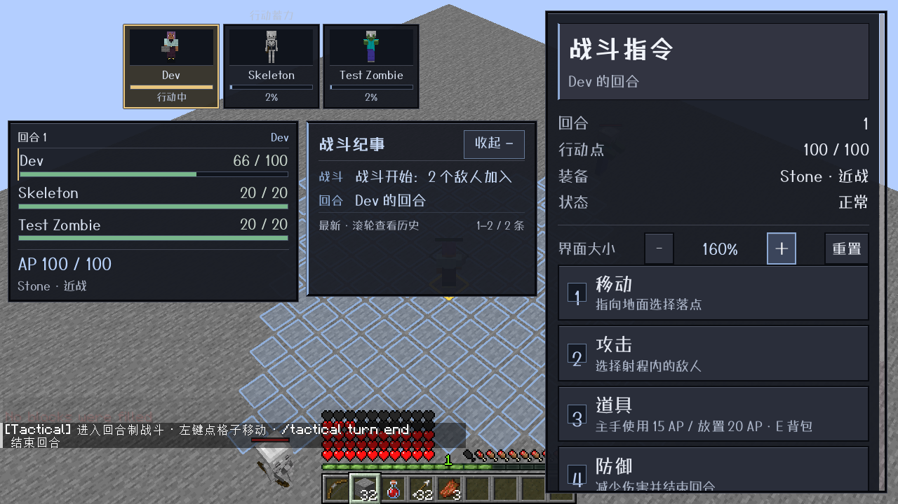

# 0.18.0 生命 HUD、头像充能、悬停定位与战术属性验收

范围：`main` / Minecraft1.21.1 / NeoForge21.1.216 / ApricityUI1.2.8 / Dungeons Perspective3.6.3。未移植其他版本。

## 实际客户端

agent自主启动 `runClient`，使用真实鼠标回调悬停、点击字号按钮、点击逃跑，并读取服务器同步状态和游戏截图。测试命令通过游戏正常命令入口执行；未直接设置客户端 AP 伪造结果。

- 左侧 HUD 现在显示参战玩家和敌人的名字、生命值/上限、血条；AP与当前装备保留在下部。生命变化会更新，不必等待额外攻击操作。
- 顶部单独显示行动蓄力卡：实际原版实体渲染的头像框、名字、0–100%进度和当前行动者高亮。头像是原生实体预览而非文字占位；超过6名时分页轮播。充能仍为原有离散ATB调度进度，不按玩家停留界面的实时时间自动涨满。
- 悬停 `Test Zombie` 名字后，镜头经过多个中间位置平移到目标，同时金色包围框高亮；移开后平滑返回当前行动者。未改变玩家位置、朝向、回合或服务器目标。实体移除、死亡、退出战斗/世界等会清理预览。
- 真实点击缩放按钮，依次覆盖60、70、80、90、100、110、125、140、160%。左侧名字、生命值、纪要文字和行距随比例改变。验证60与160的实际字体几何高度差，且纪要宽度实际变化，不再只是面板缩放而字号不变。
- 大比例时左列空间不够，纪要改用中间空位；不覆盖右侧指令或底部聊天/生命快捷栏。菜单为限高滚动布局，缩放控件位于操作按钮之前，最大比例仍能重置。
- “逃跑”按钮可见并实际点击执行，保留原有50AP概率逃跑规则：成功退出，失败耗尽本次行动并切换回合，结果写入纪要。
- `tactical ap remove @s 35` 实际减少当前 AP；`add @s 9999` 限制到上限，`remove @s 9999` 限制到0。设置 `tactical:max_ap=200` 后 HUD 即时显示新上限，当前 AP 不凭空补满，再用命令才补充。









## 原生属性

| ID | 默认 / 范围 | 规则 |
|---|---|---|
| `tactical:max_ap` |100 /1–10000|原移动速度计算的AP上限 × 最终属性值/100，四舍五入至少1。保留默认平衡，不把100强制覆盖所有生物。|
| `tactical:turn_charge_speed` |1 /0.01–100|原先攻充能速度的倍率；入场随机值不重掷。|

通过 NeoForge 原生属性注册，两个属性都同步并添加给所有有已注册属性供应器的生物类型，包括玩家与模组生物。原版 `/attribute` base/modifier 生效；修改倍率保留当前充能，降低上限会夹住当前AP，升高上限不自动补充。自己的回合开始仍恢复到当时的有效上限。

管理员命令权限2：

```mcfunction
/tactical ap get <玩家>
/tactical ap add <玩家> <数量>
/tactical ap remove <玩家> <数量>
/attribute @s tactical:max_ap base set 150
/attribute @s tactical:turn_charge_speed base set 1.5
```

数量为1–10000，目标必须是当前战斗的所属玩家。不是全服增减，也不修改敌人AP或强行插入回合。

## 自动验证

- `common`36项，NeoForge模块60项，合计96项单元/资源测试通过；包括属性速率小于1、速率更新保留进度/行动者、缩放旧配置迁移、九级尺寸和纪要安全区、头像实体ID与充能顺序codec往返。
- `runServerAttributesTest`明确 `ATTRIBUTES SELFTEST PASSED`：所有生物供应器含默认属性、原生命令及 ADD_VALUE/ADD_MULTIPLIED_TOTAL 修饰器、动态上限/速率/进度、AP命令权限、数量、指定玩家、上下限和立即S2C同步。
- `runServerSafetyTest`、`runServerRangedTest`、`runServerRegenerationTest`、`runServerDeathTest`、`runServerRegression`、`runServerCreeperTest`和`runServerEffectsTest`全部明确PASSED。
- 新网络协议为3；充能实体ID与名字/进度同序，不假定实体ID与参与者生命数组排列相同。Java旧构造器仅为源码兼容，不能让旧客户端兼容新线上协议。客户端和服务端必须同时更新0.18.0。

## 发布产物

- `tactical-neoforge-1.21.1-0.18.0.jar`：855154字节。
- SHA-256：`15e920ffabdb14ff06f3056e1497ad175499723cdcc1ae0e2778fc02dc50f68b`。
- 发布附源码jar；仅NeoForge1.21.1模块。

## 边界

原版头像预览为完整生物的小型肖像框，不是所有模组实体都拥有固定头部UV；大型或特殊渲染器仍需各自兼容。大字号在极小分辨率或极大名册下可出现滚动/自动分页；空间不足的纪要宁可隐藏也不覆盖原版聊天和HUD。当前支持单玩家战斗会话与多人在线隔离，不宣称多人合作战斗已实现。
