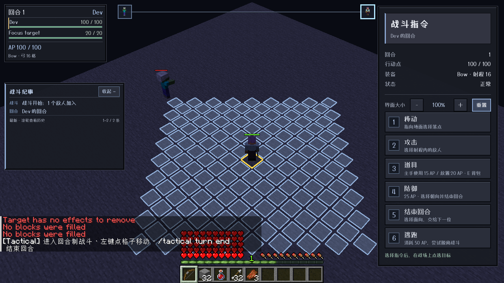
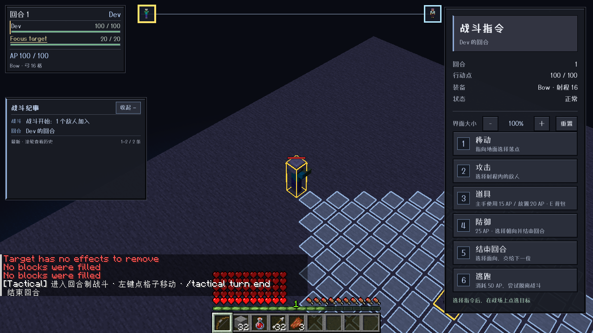
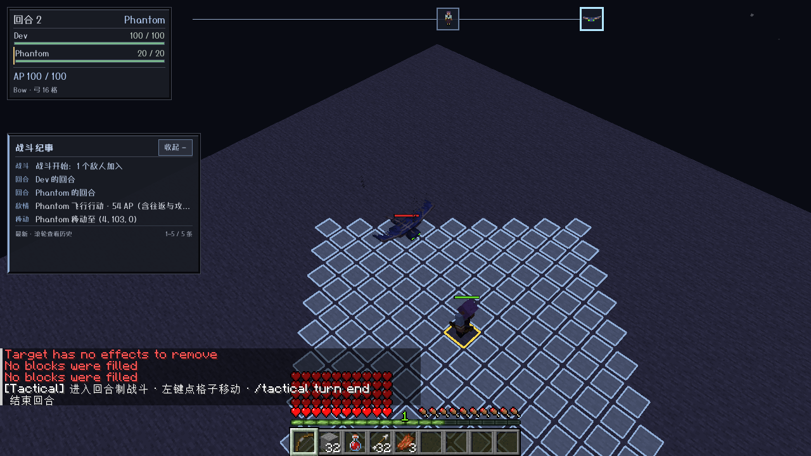
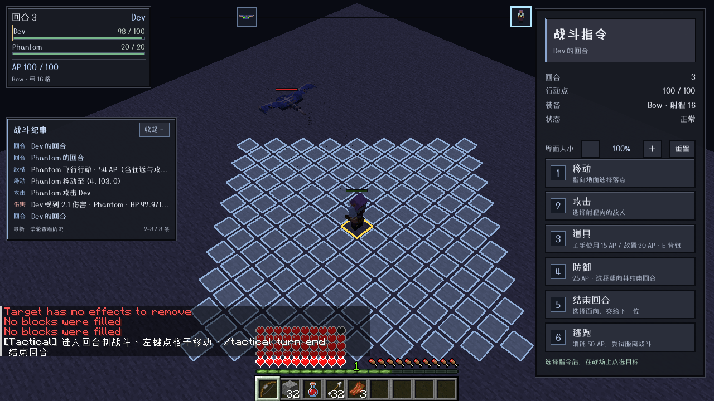
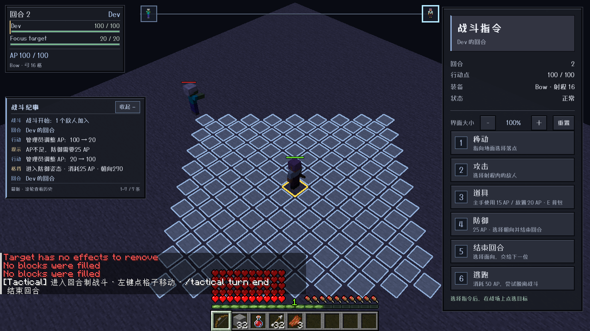

# 0.19.0 固定HUD、共享轨道、幻翼与逃跑保护验收

适用：`main`，Minecraft1.21.1 / NeoForge21.1.216 / ApricityUI1.2.8 / Dungeons Perspective3.6.3。其他版本未移植。线上协议改为4，客户端与服务端须同时更新0.19.0。

## 实际客户端

agent自主启动 `runClient`；HUD悬停、缩放、结束回合、逃跑、防御及朝向确认均经真实 Minecraft 鼠标输入回调，截图来自实际游戏。场景与伤害归因测试使用原版命令；未直接伪造客户端状态。

| 项目 | 实际验证 |
|---|---|
| 左侧固定位置 | 生命名册根节点固定左上12px；纪事固定左下安全区，底边留出聊天/原版生命和快捷栏空间，不再挪到中间。字体缩放后位置规则保持。空间不足先减行，再仅标题；极端无空间时隐藏。 |
| 单条共享轨道 | 只有一条不填充轨道，全部参与者同时显示真实实体肖像；位置按充能比例0→1计算，当前行动者在右端。没有每人独立进度条/百分比/名字卡，头像拥挤只竖直错层，不篡改进度横坐标。 |
| 悬停三联动 | 真实悬停 `Focus target` 名字，镜头聚焦、世界实体金色轮廓、对应 `charge-portrait-<id>` 添加 `charge-hovered`，并截图确认。移开恢复原行动镜头。 |
| 幻翼保留高度 | 实际幻翼入战前后保持 `(4.5,103.25,0.5)`，等待2.5秒未坠落也未攻击；结束玩家回合后拍到俯冲过程、实际玩家受伤，动作结束返回原分数高度。 |
| 逃跑保护 | 实际点击逃跑成功后，恢复普通AI的敌人在3秒等待内没有重新入战；随后原版 `/damage ... player_attack by @s` 造成玩家归因伤害，正常自动触发重新入战。200tick精确时长、投射物/吸收伤害等由专用服务器验证。 |
| 防御朝向与费用 | AP20时确认防御被拒绝，AP不变且不结束；AP100时悬停预览再返回取消不扣费；重新选择东向确认后纪要记录25AP费用并结束回合。四个方向通过网络codec往返测试。 |

## 服务端与自动测试

- `common`36项，NeoForge模块75项，合计111项单元/资源测试通过。新增空中路径/AP预算/完整返程标记、逃跑倒计时与玩家隔离、共享轨道比例与重叠处理、底部锚定几何、防御四方向网络codec。
- `runServerFlightTest`明确 `FLIGHT SELFTEST PASSED`：真实ServerPlayer和幻翼，精确分数空中部署、完整身体/屋顶/途中阻挡/玩家身体检查、完整自身回合原版伤害一次与返程、实际AP扣除、非自身回合悬停和预算不足只接近。
- `runServerFleeTest`明确 `FLEE SELFTEST PASSED`：实际成功逃跑和结束清理、200个真实服务端tick、目标/受伤者/脑记忆/愤怒清理、不影响其他玩家、原生重新锁定被阻止；真实直接/箭矢伤害取消，玩家/TNT/云/宠物等来源归因；取消、零伤害不取消，吸收生命真正消耗会取消；正常自动触发开关仍生效。
- `runServerAttributesTest`、`runServerSafetyTest`、`runServerRangedTest`、`runServerDeathTest`、`runServerRegression`明确PASSED。
- `runServerRegenerationTest`、`runServerCreeperTest`、`runServerEffectsTest`明确PASSED，未破坏原有食物/药水/燃烧/苦力怕时钟。
- 打包检查包括版本、Mixin及插件/类、字体和HUD资源；测试桥接模组不打入发布jar。

## 实现边界与测试发现

幻翼完整俯冲先支付 `路径总步数×移动费用+30攻击AP`，路径包含返程，只有到达攻击点才进行一次原版攻击。预算不够则付费接近，不送免费攻击或回返。规划和动画每段检查全身体积；动作途中出现新障碍则停在安全空位并退还未执行部分费用，不保证穿过新障碍强行回家。回合间冻结普通AI并保持空中坐标，不把飞行生物压到地面。

移动策略目前识别 `Phantom`、`FlyingMob`、`Vex`，仅精确注册普通幻翼的专用俯冲AI；其他受支持的飞行类型使用空中移动策略与既有通用行为，不等于所有第三方自定义飞行AI均已适配。空中格为三维26邻接、每步同费；碰撞扫掠包围盒对角线较保守，可能放弃一些狭窄但理论可穿越的路径。

实际回归发现并修复：飞行返回路径不能把行动者自己的起飞格判为占用，否则会被误退化为只接近；最后一步到达后需消除原版tick间的漂移。旧测试用默认最大吸收值0直接加吸收生命没有真正生效，现先设置原版最大吸收属性再测。吸收生命受到真实伤害也属于玩家造成伤害，会取消保护；完整格挡、取消与零伤害不会取消。

逃跑保护不是无敌，不阻止环境伤害或已在途的外部危害。仅玩家的实际生命/吸收伤害会打破自己的保护，挥空不打破；其归因来自真实DamageSource与所有者链。激活后每tick清理已加载生物的对应目标/记忆，不改动其他玩家的仇恨。自然仇恨/入战仍尊重自动触发开关。当前仍是单玩家战斗会话和多人在线身份隔离，不新增共同参战。

## 发布产物

- `tactical-neoforge-1.21.1-0.19.0.jar`：902014字节。
- SHA-256：`3f0cc2ebc70a5c31b0506b42224e1c2b4f8b6e6988b5c991b3336faf7cd5c4ed`。
- 发布另附源码jar；仅NeoForge1.21.1模块。
