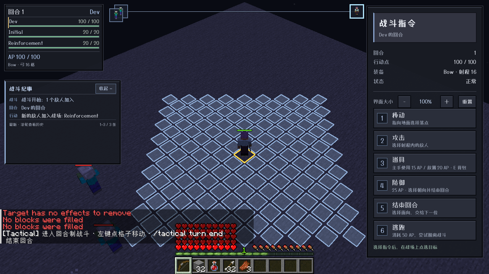
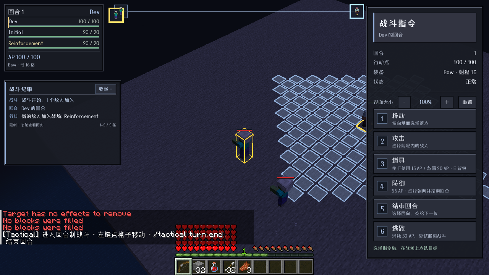
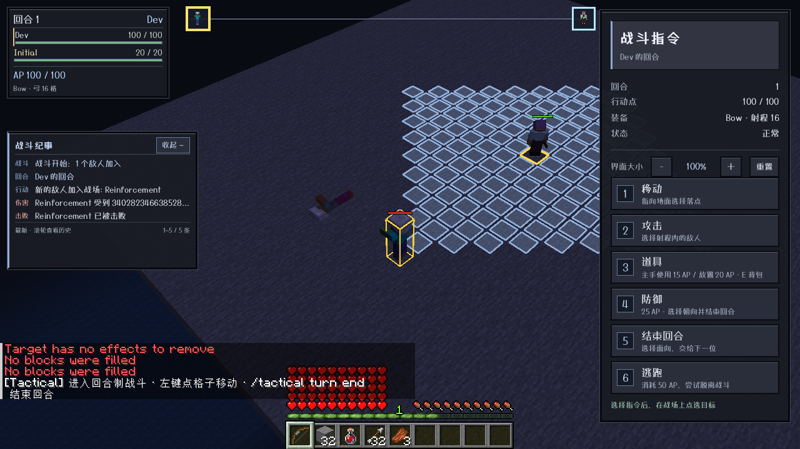

# 0.19.1 中途增援与头像反向联动验收

范围：main / Minecraft1.21.1 / NeoForge21.1.216 / ApricityUI1.2.8 / Dungeons Perspective3.6.3。未移植其他版本。

## 根因与修复

旧逻辑每次仇恨扫描会清掉非参与者对玩家的目标，并冻结场内溢出实体，使它们很难成为中途增援；而外部攻击吸收路径没有数量上限检查。

现在每10个服务端tick（正常约0.5秒）扫描当前区域包围盒向外扩8格内的存活敌对生物，要求其原生目标正是战斗所属玩家。按距离、实体ID稳定排序，在敌人名额不足时尝试安全部署并加入已有队列；数量上限仅计敌人、不计玩家，直接攻击吸收也遵守同一上限。不会强制清除或冻结溢出/无仇恨/以其他玩家为目标的实体。

初始部署只考虑区域内候选，并以成功部署数计算上限，不因前面一个无安全位置的候选浪费名额。参与者死亡后立即重扫，再判定胜利；即使旧名册同时清空，只要附近已有有仇恨且能加入的敌人，继续同一场战斗，不重置AP、回合和已积累充能。

头像加入与左侧名字相同的定位入口：悬停顶部头像，高亮左侧对应名字、轨道肖像与世界实体，镜头平滑聚焦；移开恢复当前行动者。不同悬停来源独立清理，头像重建、实体死亡/离开、关闭战斗不会留下旧ID焦点。

## 实际客户端

agent自主启动runClient，场景用原版命令布置，头像悬停通过真实鼠标回调执行；未直接改客户端状态。

1. 初始只有一个测试敌人，战斗中再生成普通AI启用的僵尸。它通过原版目标获取机制产生仇恨，自动加入现有战斗；客户端名册/头像立即出现，新加入时玩家AP与行动计数不变，原敌人仍在。
2. 鼠标移到新加入者头像，实际名册节点包含health-hovered、头像包含charge-hovered，镜头经过平移聚焦该实体，世界轮廓高亮，截图确认。
3. 移开恢复当前行动者；再次悬停后杀死该增援，名册/头像移除且焦点清理，原敌人仍在战斗，没有错误退出。

## 自动与专用服务器

- 普通单元/资源测试共111项（common36、NeoForge75），全部通过；打包检查包括新增增援场景及现有Mixin、字体/UI和版本，不携带Agent Helper。
- `runServerReinforcementTest`明确REINFORCEMENT SELFTEST PASSED。真实ServerPlayer和跨区块生物；cap=2验证敌人上限不包含玩家、原生setTarget触发加入、10tick内补缺、全死仍有候补时不提前结束、AP/阶段/当前会话不重置、重复实体不重复入队、飞行增援保持高度、远处生物不被任意吸入、直接外部攻击可扩区但不能越过上限、逃跑保护期间不招募、其他玩家目标和原本NoAI旁观者保持原状、状态包只发送给所属玩家。
- 第一次增援场景失败是错误地要求逃跑保护拒绝目标后变成null；正确行为是保留它之前的其他玩家目标。修正断言后重跑通过，未改变生产行为。
- `runServerFleeTest`、`runServerFlightTest`、`runServerRangedTest`、`runServerDeathTest`、`runServerRegression`分别明确PASSED。
- 属性、安全部署、食物/再生、苦力怕与药水效果场景全部回归通过，对应日志含明确PASSED标记，不只依赖进程退出码。

## 边界

增援必须有真实仇恨，普通中立/远处未锁定玩家的实体不会仅因出生就加入。满员时未入战敌人仍按原版AI行动，攻击战场内目标会被既有场内外伤害规则限制；出现名额后再尝试入场。实体没有安全部署点时保持场外并等待后续扫描，不强塞进方块。

扫描依据当前区域包围盒加8格，不是全世界全服搜索；玩家逃跑保护、死亡或战斗已结束时不会招募。当前仍是单玩家战斗会话与多人在线隔离。协议保持4，推荐客户端/服务端同时使用0.19.1。

## 发布产物

- `tactical-neoforge-1.21.1-0.19.1.jar`：914759字节。
- SHA-256：`3ec38110a942cf1d0d53058b095ed259047d1843eed1cd6b657a3e411c938f12`。
- 发布另附源码jar；仅NeoForge1.21.1模块。
